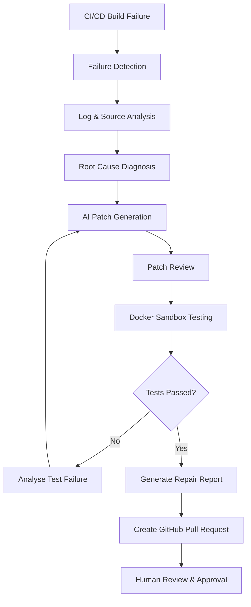

# ⚡ REAPER — Autonomous Software Repair Engine

<p align="center">
  <strong>Detect. Diagnose. Repair. Verify.</strong>
</p>

<p align="center">
  An AI-powered autonomous software repair engine that detects CI/CD failures, investigates root causes, generates intelligent code fixes, and validates patches in isolated environments.
</p>

<p align="center">
  
  
  
  
  
</p>

---

## 🚀 Overview

Modern software development depends on CI/CD pipelines, automated testing, and continuous integration. However, when builds fail, developers often spend hours manually investigating logs, locating bugs, modifying source code, and validating fixes.

**REAPER (Autonomous Software Repair Engine)** aims to automate this entire debugging and repair workflow.

REAPER uses AI-powered analysis and autonomous agents to understand software failures, identify root causes, generate code modifications, and test patches in isolated Docker environments.

Instead of simply reporting errors, REAPER aims to help developers move from failure to a verified solution.

## 🎯 Problem Statement

Software development teams frequently face challenges such as:

- Repeated CI/CD pipeline failures.
- Time-consuming manual debugging.
- Difficulty identifying root causes from large error logs.
- Dependency and configuration conflicts.
- Manual code patching and regression testing.
- Delayed development cycles due to repetitive repair tasks.

Traditional debugging tools often identify problems but leave the actual repair process to developers.

REAPER aims to bridge this gap through autonomous software diagnosis and repair.

## 💡 Our Solution

REAPER introduces an AI-driven software repair workflow that:

1. Detects failed CI/CD builds.
2. Collects relevant logs and source-code context.
3. Analyses errors and identifies possible root causes.
4. Generates context-aware code patches.
5. Reviews proposed changes.
6. Tests patches in isolated Docker environments.
7. Produces detailed repair reports.
8. Prepares GitHub Pull Requests for human review.

**Human approval remains mandatory before accepting changes.**

## ⚙️ How REAPER Works



## 🧠 Core Features

### 1. AI-Powered Error Analysis

- Analyse CI/CD failure logs.
- Understand stack traces and error messages.
- Identify potential root causes.
- Provide understandable explanations.

### 2. Autonomous Code Repair

- Generate context-aware patches.
- Suggest modifications across relevant files.
- Review generated changes.
- Track repair attempts.

### 3. Multi-Model AI Architecture

Designed to support multiple AI providers:

| Provider | Intended Responsibility |
|---|---|
| Google Gemini | Log analysis and code understanding |
| OpenAI GPT | Independent reasoning and patch review |
| Anthropic Claude | Complex bug diagnosis and repair |

A centralized AI orchestrator selects providers according to task requirements.

### 4. Isolated Docker Testing

- Execute tests in isolated containers.
- Apply resource limits.
- Enforce execution timeouts.
- Capture test output.
- Validate generated patches before acceptance.

### 5. GitHub Integration

Planned capabilities include:

- Repository access.
- CI/CD workflow monitoring.
- Failed build log retrieval.
- Branch and commit creation.
- Pull Request generation.
- Repair status tracking.

### 6. Repair History & Reports

- Track previous repair attempts.
- Store diagnosis results.
- Display generated patches.
- Record test outcomes.
- Generate repair reports.

### 7. Security & Human Oversight

- Secure authentication.
- Protected API endpoints.
- Isolated code execution.
- Audit logging.
- Human approval before accepting changes.
- No automatic production merges.

## 🏗️ Technology Stack

| Category | Technologies |
|---|---|
| Frontend | React.js, Vite, JavaScript |
| Backend | Python, FastAPI |
| Database | PostgreSQL, Supabase |
| ORM | SQLAlchemy |
| AI Models | Gemini, OpenAI GPT, Claude |
| Background Jobs | Redis, Celery |
| Code Isolation | Docker |
| Version Control | Git, GitHub |
| Testing | Pytest |

*The stack represents the planned architecture. Individual integrations depend on implementation and configuration.*

## 📂 Project Structure

```text
REAPER/
│
├── frontend/
│   ├── public/
│   │   └── branding/
│   └── src/
│       ├── components/
│       ├── pages/
│       ├── services/
│       ├── styles/
│       └── App.jsx
│
├── backend/
│   ├── app/
│   │   ├── api/
│   │   ├── agents/
│   │   ├── core/
│   │   ├── database/
│   │   ├── integrations/
│   │   ├── models/
│   │   ├── sandbox/
│   │   ├── schemas/
│   │   ├── services/
│   │   ├── tasks/
│   │   └── main.py
│   │
│   ├── tests/
│   ├── migrations/
│   ├── requirements.txt
│   └── .env.example
│
└── README.md
```

*The structure describes the intended organization and may evolve during development.*

## 🛠️ Getting Started

### Prerequisites

Install the following tools:

- Python 3.12+
- Node.js and npm
- Git
- Docker Desktop
- PostgreSQL or Supabase account

### 1. Clone the Repository

```bash
git clone YOUR_REPOSITORY_URL
cd REAPER
```

### 2. Frontend Setup

```bash
cd frontend
npm install
npm run dev
```

Frontend development server:

```text
http://localhost:5173
```

### 3. Backend Setup

Open another terminal:

```bash
cd backend
python -m venv venv
```

Activate the environment on Windows:

```powershell
.\venv\Scripts\Activate.ps1
```

Install dependencies:

```bash
pip install -r requirements.txt
```

Start FastAPI:

```bash
uvicorn app.main:app --reload --port 8000
```

Backend server:

```text
http://localhost:8000
```

API documentation:

```text
http://localhost:8000/docs
```

### 4. Environment Configuration

Create a `.env` file inside the backend directory using `.env.example` as a reference.

```env
DATABASE_URL=

JWT_SECRET_KEY=

REDIS_URL=

GEMINI_API_KEY=
OPENAI_API_KEY=
ANTHROPIC_API_KEY=

SMTP_HOST=
SMTP_PORT=
SMTP_USERNAME=
SMTP_PASSWORD=

GITHUB_APP_ID=
GITHUB_PRIVATE_KEY=
GITHUB_WEBHOOK_SECRET=

FRONTEND_ORIGIN=http://localhost:5173

ENABLE_GITHUB_INTEGRATION=false
```

Never commit `.env` files or expose API keys publicly.

### 5. Docker Setup

Install and start Docker Desktop before running sandbox-related services.

Use the project's Docker Compose configuration when the required services have been implemented and configured.

## 🔐 Security Principles

REAPER is designed around security-first software repair.

- Treat repository files and build logs as untrusted input.
- Never execute untrusted code directly on the backend host.
- Use isolated, resource-limited execution environments.
- Protect API credentials and secrets.
- Validate AI-generated patches.
- Maintain execution logs and audit trails.
- Require human approval before accepting generated changes.

## 🗺️ Development Roadmap

- [x] Project concept and architecture planning
- [x] Frontend project foundation
- [x] REAPER brand identity
- [ ] Email authentication integration
- [ ] Database integration
- [ ] Multi-provider AI orchestration
- [ ] CI/CD failure detection
- [ ] Automated root cause analysis
- [ ] AI-powered patch generation
- [ ] Docker sandbox integration
- [ ] Automated patch validation
- [ ] GitHub Pull Request integration
- [ ] Repair analytics and reporting
- [ ] End-to-end testing

*Update roadmap items as features are actually implemented and verified.*

## 👥 Team CiPher

<p align="center">
  <strong>Building Intelligent Systems. Engineering Autonomous Solutions.</strong>
</p>

### Team Members

| Member | Specialization |
|---|---|
| **Archi Sharma** | AI/ML |
| **Parth Goyal** | CSCQ |

<p align="center">
  <strong>Built by CiPher</strong><br/>
  Engineering autonomous software repair.
</p>

## 🌟 Our Vision

Our vision is to make software debugging and repair faster, more intelligent, and more accessible.

REAPER aims to transform traditional debugging workflows into autonomous, AI-assisted engineering processes where developers spend less time investigating repetitive failures and more time building innovative software.

## 📜 License

This project is currently under development. A license will be added when the repository's licensing terms are finalized.

---

<p align="center">
  <strong>REAPER — Detect. Diagnose. Repair. Verify.</strong>
  <br/>
  <sub>Powered by AI. Built for Developers. Created by CiPher.</sub>
</p>
