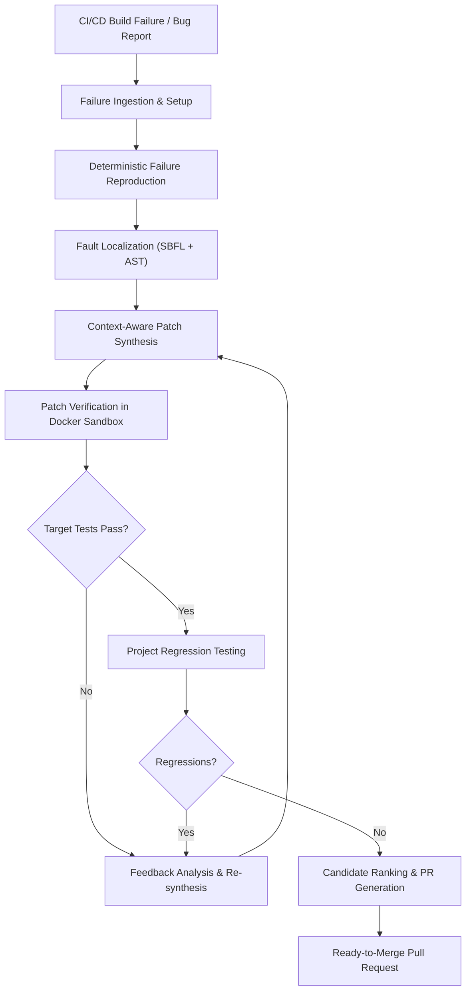

<p align="center">
  
</p>

<h1 align="center">REAPER</h1>
<h3 align="center">Autonomous Software Repair Engine</h3>

<p align="center">
  <em>"Your Code Breaks. REAPER Fixes."</em>
</p>

<p align="center">
  <a href="#system-architecture"></a>
  <a href="#tech-stack"></a>
  <a href="#tech-stack"></a>
  <a href="#tech-stack"></a>
  <a href="#license"></a>
</p>

---

## ⚡ Executive Summary

**REAPER** is an autonomous, multi-agent AI software repair platform engineered to eliminate debugging downtime. When software pipelines break, REAPER automatically ingests failure reports, reproduces bugs in isolated sandboxes, localizes faults down to exact lines of code, synthesizes verified semantic patches, runs full regression suites, and drafts ready-to-merge Pull Requests.

Designed with an **Obsidian Emerald** visual identity, REAPER pairs an interactive, high-cadence developer dashboard with an asynchronous, high-throughput Python backend.

---

## 🎯 Problem & Solution

### The Problem
Modern engineering teams spend up to 40% of development cycles investigating continuous integration failures, sifting through massive stack traces, and manually constructing hotfixes. Traditional linters and telemetry tools flag errors, but leave manual root cause isolation, patch development, and verification entirely to the developer.

### The Solution: Autonomous Repair Workflow
REAPER bridges the gap between failure detection and verified resolution:
1. **Ingests** broken CI/CD runs, stack traces, and bug reports.
2. **Reproduces** failure scenarios deterministically in sandboxed runtimes.
3. **Pinpoints** buggy AST statements via Spectrum-Based Fault Localization (SBFL).
4. **Synthesizes** surgical, idiomatic patches using multi-model AI reasoning.
5. **Validates** fixes against isolated test boundaries and runs regression suites.
6. **Publishes** human-auditable Pull Requests with detailed diagnosis and logs.



---

## 🏛️ System Architecture

```
                                  +---------------------------------------+
                                  |         REAPER Frontend (Vite)        |
                                  |  - Obsidian Emerald Design System     |
                                  |  - Real-time Pipeline Monitor         |
                                  |  - Interactive Code Diff Viewer       |
                                  +-------------------+-------------------+
                                                      |
                                        REST APIs / WebSockets
                                                      |
                                                      v
                                  +---------------------------------------+
                                  |          FastAPI Backend Core         |
                                  |  - Dual-Token JWT Authentication      |
                                  |  - SQLAlchemy 2.0 / Alembic           |
                                  |  - PostgreSQL / Supabase Engine       |
                                  +-------------------+-------------------+
                                                      |
                   +----------------------------------+----------------------------------+
                   |                                                                     |
                   v                                                                     v
+--------------------------------------+                              +--------------------------------------+
|       Multi-Agent AI Repair Core     |                              |      Secure Execution Sandboxes      |
|  1. Analysis Agent                   |                              |  - Docker Containerized Runners      |
|  2. Fault Localization Agent         |                              |  - Isolated Subprocess Fallback      |
|  3. Patch Generation Agent           |                              |  - Resource Quotas & Non-Root User   |
|  4. Sandbox Execution Agent          |                              |  - Ephemeral Workspace Cleanup       |
|  5. Regression Testing Agent         |                              +--------------------------------------+
|  6. Pull Request Agent               |
+--------------------------------------+
```

---

## 🤖 The 6 Specialized AI Repair Agents

REAPER partitions the complex problem of automated program repair across six autonomous, specialized agents:

1. **Analysis Agent**: Synthesizes stack traces, error telemetry, and commit histories to define reproduction steps and root symptoms.
2. **Fault Localization Agent**: Combines Spectrum-Based Fault Localization (SBFL) with semantic AST analysis to identify suspect modules and lines.
3. **Patch Generation Agent**: Generates candidate code diffs matching project conventions and language idioms using high-reasoning LLMs.
4. **Sandbox Execution Agent**: Dispatches test runners inside isolated execution boundaries to confirm bug reproduction and patch efficacy.
5. **Regression Testing Agent**: Runs full test suites to verify that bug fixes introduce zero regressions or side-effects.
6. **Pull Request Agent**: Compiles comprehensive patch narratives, verification telemetry, and generates clean GitHub Pull Requests.

---

## 🔄 The 10-Stage Autonomous Repair Pipeline

Every repair execution follows a deterministic, 10-stage state machine:

```
[1. INGESTION] ──────► [2. ENV SETUP] ──────► [3. REPRODUCE] ──────► [4. LOCALIZATION]
                                                                              │
                                                                              ▼
[8. REGRESSION] ◄──── [7. VERIFY] ◄────────── [6. CANDIDATE] ◄─────── [5. CONTEXT]
       │
       ▼
[9. RANKING] ───────► [10. PR GENERATION] ──► (Verified Fix Published)
```

1. **Ingestion**: Ingests repository metadata, issue descriptions, and target branches.
2. **Environment Setup**: Provisions ephemeral workspace and resolves dependencies.
3. **Failure Reproduction**: Replays failure commands to verify reproducibility.
4. **Fault Localization**: Pinpoints suspect AST nodes and ranks suspect lines.
5. **Context Gathering**: Gathers surrounding functions, dependencies, and type signatures.
6. **Candidate Generation**: Synthesizes multiple candidate patches.
7. **Sandbox Verification**: Executes target test cases against patched code.
8. **Regression Testing**: Validates non-regression across all existing test suites.
9. **Patch Ranking**: Selects the highest quality, most minimal working patch.
10. **PR Generation**: Formats and publishes a ready-to-merge Pull Request.

---

## 🎨 Design System: "Obsidian Emerald"

REAPER features an elite visual identity crafted for engineering clarity:

- **Deep Obsidian** (`#101713`): Core background canvas.
- **Dark Forest** (`#18251E`): Layered surface for cards and panes.
- **Forest Surface** (`#1D3026`): Floating panels and elevated components.
- **Emerald Accent** (`#42D6A4`): Primary actions, success indicators, and live telemetry.
- **Soft Mint** (`#A1E9C9`): Secondary highlights and badges.
- **Champagne Gold** (`#C9A96E`): Premium metrics, warnings, and special indicators.
- **Warm Ivory** (`#E8E6DD`): High-legibility text hierarchy.
- **Muted Sage** (`#89998E`): Low-contrast metadata and descriptions.

---

## 🛠️ Tech Stack

### Frontend
- **Framework**: React 18 with Vite
- **Styling**: Tailwind CSS with custom Obsidian Emerald tokens
- **Icons**: Lucide React + Custom SVG Brand System
- **State & Routing**: Context API, React Hooks, Client Router

### Backend
- **Framework**: FastAPI (Python 3.12+)
- **ORM & Migrations**: SQLAlchemy 2.0 (Async/Sync) with Alembic
- **Database**: PostgreSQL / Supabase with SQLite local fallback
- **Authentication**: JWT Dual-Token (Access + Refresh) & Argon2 Password Hashing
- **Execution Sandboxing**: Docker SDK with process isolation fallback
- **Test Suite**: Pytest with unit, integration, and mock suites

---

## 🚀 Quickstart Guide

### 1. Prerequisites
- **Node.js**: v18.0.0 or higher
- **Python**: v3.12 or higher
- **Docker** (Optional, recommended for sandboxed test execution)
- **Git**

### 2. Clone Repository
```bash
git clone https://github.com/goyalparth61-netizen/REAPER.git
cd REAPER
```

### 3. Backend Setup
```bash
cd backend

# Create and activate virtual environment
python -m venv venv
# Windows:
.\venv\Scripts\activate
# Linux/macOS:
source venv/bin/activate

# Install dependencies
pip install -r requirements.txt

# Configure environment
cp .env.example .env

# Run database migrations
alembic upgrade head

# Run backend development server
uvicorn app.main:app --host 127.0.0.1 --port 8000 --reload
```
API Documentation will be available at: `http://localhost:8000/docs`

### 4. Frontend Setup
```bash
cd frontend

# Install dependencies
npm install

# Start Vite development server
npm run dev
```
Open your browser at: `http://localhost:5173`

### 5. Running Tests
```bash
# Backend unit & integration test suite
cd backend
pytest tests/ -v

# Frontend production build verification
cd frontend
npm run build
```

---

## 🛡️ Security & Sandbox Principles

- **Network Isolation**: Sandbox containers operate with strict network restrictions to prevent telemetry leakage.
- **Zero Secrets Committed**: All environment configurations rely on `.env.example` templates; sensitive keys are strictly excluded via `.gitignore`.
- **Resource Quotas**: Hard timeouts (default 30s) and CPU/memory quotas on execution runners prevent infinite loops and denial-of-service.
- **Non-Root Execution**: Sandbox containers execute under unprivileged user IDs (`uid: 1000`).

---

## 🗺️ Project Implementation Status

- [x] Multi-Agent Repair Architecture (6 specialized agents)
- [x] 10-Stage Deterministic Repair State Machine
- [x] Dual-Token JWT Authentication & Argon2 Password Hashing
- [x] PostgreSQL & SQLAlchemy 2.0 ORM with Alembic Migrations
- [x] Docker Containerized Sandbox Runner & Fallback Subprocess Runner
- [x] Obsidian Emerald UI Design System & Live Animated Mascot
- [x] RESTful API endpoints & WebSocket Telemetry Stream
- [x] Comprehensive Automated Pytest Suite (17 tests passing)
- [x] Mock GitHub Integration Service

---

## 👥 CiPher — Founding Team

<div align="center">

| Member | Specialization | Role |
| :--- | :--- | :--- |
| **1. Archi Sharma** | **AI / ML** | Neural Architecture & Multi-Agent Reasoning |
| **2. Parth Goyal** | **CSCQ** | System Security, Architecture & Sandboxing |

</div>

<br>

<p align="center">
  <strong>Built by CiPher</strong><br>
  <em>Engineering autonomous software repair.</em>
</p>

---

## 📄 License
This project is licensed under the MIT License - see the [LICENSE](LICENSE) file for details.
